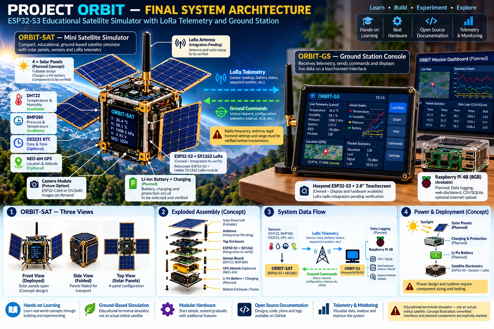

# Project ORBIT

## A Modular Satellite Engineering and Ground-Station Platform

Project ORBIT is a terrestrial engineering and educational platform combining embedded computing, environmental sensing, planned LoRa communications, an onboard status display, and a future ground station. It is not an orbital spacecraft.



## Current verified status

**Phase 1 — board bring-up is underway.**

- Received board: Heltec-branded ESP32-S3 board, visible PCB marking `HTIT-WB32LAF` and `V3.2`.
- Packaging identifies an SX1262 and advertises 863–928 MHz.
- Official firmware path: `firmware/orbit_sat/`.
- PlatformIO build succeeded with `heltec_wifi_lora_32_V3`; build output reported ESP32-S3 and 8 MB flash for that target definition.
- ORBIT firmware booted. OLED status was observed, including `RADIO: SAFE / OFF` and `STATUS: READY`; serial output included `OLED=READY` and `state=SAFE_IDLE`.

These observations confirm a successful build and basic runtime/display status. They do **not** confirm LoRa initialization or communication, sensor integration, ground-station operation, or battery/solar operation.

## System overview

### ORBIT-SAT — onboard unit
The current onboard unit is the Heltec-branded ESP32-S3/SX1262 board. Sensor acquisition, GPS, LoRa packet communication, commands, and power telemetry remain future integrations unless separately tested and documented.

### ORBIT-GS — ground station
The Hosyond ESP32-S3 touchscreen board is available for UI experiments. Its role as the primary console and its radio interface remain unverified. No working ground-station link is established.

### Logging and visualization
A Raspberry Pi 4B (8 GB) is available for future telemetry ingestion, storage, and browser-based visualization. No ORBIT logging service or dashboard is confirmed operational.

## Build

From the repository root:

```bash
cd ORBIT/firmware/orbit_sat
pio run -e heltec_wifi_lora_32_V3
```

The documented build succeeded in the recorded environment. Before uploading, connect the board and confirm the serial port and upload settings:

```bash
pio run -e heltec_wifi_lora_32_V3 -t upload
pio device monitor -b 115200
```

## Safety and engineering constraints

- Keep radio transmission disabled until the exact radio variant, antenna/connector compatibility, permitted frequency, and applicable Indian operating requirements have been verified.
- Verify board-specific GPIO and peripheral interfaces before wiring.
- Do not connect batteries or solar panels until charging/protection, regulation, voltage/current limits, and wiring have been engineered.
- Diagrams and roadmap items are not evidence of implemented functionality.
- Preserve build output, serial logs, and test results.

## Repository layout

```text
ORBIT/
├── README.md
├── docs/
│   ├── ARCHITECTURE.md
│   ├── BRINGUP_CHECKLIST.md
│   ├── HARDWARE_INVENTORY.md
│   ├── ORBIT_Architecture_Detailed.jpg
│   └── PHASE_PLAN.md
├── firmware/orbit_sat/
│   ├── platformio.ini
│   ├── README.md
│   └── src/main.cpp
└── ground-station/README.md
```

## Roadmap

1. Confirm board identity and repeatable build/boot.
2. Document and validate the OLED implementation.
3. Verify radio/antenna/frequency/regulatory compatibility; initialize without transmitting where supported.
4. Integrate sensors and define a versioned telemetry schema.
5. Implement ground-station reception, logging, and visualization.
6. Add validated commands and acknowledgements.
7. Engineer and test battery/solar power.
8. Conduct documented terrestrial end-to-end tests.
9. Consolidate results and limitations.
